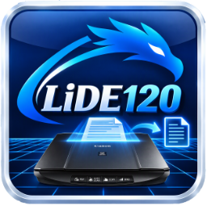

```
   _._
 o|- -|o This file is licensed under GNU GPL 2.0 international license.
  ( l )  To view a copy of this license, visit http://creativecommons.org/licenses/by-nc-sa/4.0/
    =    Author: jean-marc "jihem" quere 2026
```

[](https://lipunila.sonaliwan.fr)
# Numérisation avec le Canon CanoScan LiDE 120, sans pilote du fabricant

Cette application Lexis+ pilote **directement** le scanner Canon CanoScan
LiDE 120 (USB `04a9:190e`, puce Genesys **GL124**). Elle ne passe ni par le
pilote Canon, ni par TWAIN, WIA ou SANE. Elle envoie elle-même les commandes
USB à la puce :

- amorçage de la puce et retour de la tête en position de repos ;
- étalonnage des diodes, du noir et du blanc, avec envoi des coefficients
  d'ombrage, des tables gamma et des pentes d'accélération du moteur ;
- numérisation et lecture des lignes du capteur CIS.

```
wdlexisrt exemples/lide120/principal.prg                 interface graphique
wdlexisrt exemples/lide120/principal.prg --simulation    sans scanner
wdlexisrt exemples/lide120/principal.prg --essai --usb   essai en ligne de commande
```

## Ce que fait l'application

- **Aperçu** : toute la vitre est lue à 75 dpi. Sur la toile, on choisit
  ensuite la zone à numériser en déplaçant ou en redimensionnant le cadre bleu.
  On peut aussi saisir la zone en millimètres ou choisir un format (A4, A5,
  Lettre US, photo 10 × 15, carte de visite…).
- **Numériser** :
  - résolutions : 75, 100, 150, 300, 600, 1200 ou 2400 dpi ;
  - modes : couleur, gris ou trait (noir et blanc) ;
  - profondeur : 8 ou 16 bits par canal ;
  - retouches : luminosité, contraste et rotation.
- **Enregistrement** :
  - formats : PDF, JPEG (qualité réglable), PNG (8 ou 16 bits) ou TIFF (8 ou
    16 bits, non compressé) ;
  - nom horodaté, dans le dossier `~/Numérisations` par défaut ;
  - *Plusieurs pages* : chaque numérisation ajoute une page au document ;
    *Enregistrer le document* écrit alors un PDF de toutes les pages.
- **Boutons du scanner** :
  - Numériser et Fichier lancent une numérisation ;
  - Copier fait un aperçu ;
  - Courriel ajoute la page au document et enregistre le PDF.
- **Diagnostic** :
  - état du scanner (tête au repos, moteur, lampe, boutons) et registres
    programmés ;
  - *Refaire l'étalonnage* et *Ramener la tête* ;
  - *Tracer l'USB* journalise chaque transfert, pour comparer avec une
    capture faite sous le pilote d'origine.
- **Arrêter** interrompt la numérisation en cours et ramène la tête au repos.

Le premier passage à une résolution donnée commence par l'étalonnage, qui
prend quelques secondes. L'étalonnage est ensuite gardé une heure pour cette
résolution et cette zone, comme le fait SANE.

## Installation

L'application a besoin de la bibliothèque **libusb-1.0**. Le paquet `usb` la
cherche :

1. dans la variable `WDLEXIS_LIBUSB` ;
2. dans les dossiers `linOS`, `macOS` ou `winOS` à côté de l'exécutable ;
3. aux emplacements habituels du système.

### Linux

libusb est presque toujours installée (paquet `libusb-1.0-0`). Pour utiliser
le scanner sans être root, ajoutez une règle udev, puis débranchez et
rebranchez le scanner :

```
# /etc/udev/rules.d/60-lide120.rules
SUBSYSTEM=="usb", ATTR{idVendor}=="04a9", ATTR{idProduct}=="190e", MODE="0666"
```

Si SANE est installé, il ne gêne pas tant qu'aucun programme de numérisation
ne l'utilise en même temps.

### Windows

Le scanner doit utiliser le pilote générique **WinUSB** à la place du pilote
Canon. L'outil Zadig (zadig.akeo.ie) fait ce remplacement : choisissez
« CanoScan » puis « WinUSB » et cliquez *Replace Driver*. Il faut aussi
`libusb-1.0.dll` (libusb.info) dans le dossier `winOS` à côté de wdlexisrt.

Pour revenir au pilote Canon, désinstallez le périphérique dans le
Gestionnaire de périphériques.

### macOS

Installez libusb avec `brew install libusb`. Si un logiciel de numérisation
(Transfert d'images, pilote Canon) garde le scanner ouvert, fermez-le d'abord.

## Organisation du pilote

| Fichier | Rôle |
| --- | --- |
| `lide120.prg` | Le modèle et ses tables : géométrie, réglages du capteur pour chaque résolution, profils du moteur, frontal analogique, GPIO, organisation de la mémoire. |
| `registres.prg` | Jeux de registres (ordre d'écriture, valeurs 8 / 16 / 24 bits) et opérations sur les bits. |
| `transport.prg` | Protocole USB du GL124 : registres (valeur suivie de `0x55`), en-têtes de lecture, mémoire AHB, frontal. |
| `session.prg` | Géométrie d'une numérisation (`compute_session`) et pentes d'accélération du moteur. |
| `gl124.prg` | Commande de la puce : registres initiaux, registres optiques et moteur, marche et arrêt, déplacements, retour au repos, gamma, amorçage. |
| `etalonnage.prg` | Étalonnage des diodes, du noir et du blanc, coefficients d'ombrage, cache des étalonnages. |
| `numeriser.prg` | Interface du pilote : `SCANNER_OUVRIR`, `NUMERISER`, `SCANNER_BOUTONS`, `SCANNER_ARRETER`, retouches. |
| `simulateur.prg` | LiDE 120 simulé (voir plus bas). |
| `principal.prg` | Interface graphique, essai et comparaison en ligne de commande. |

Le pilote utilise trois paquets de Lexis+ écrits en Nim pur :

- `usb` pour les transferts USB (libusb) ;
- `trame` pour l'assemblage des lignes du capteur, les retouches et les
  formats d'image et PDF ;
- `binaire` pour les opérations bit à bit.

Les transferts USB libèrent l'interpréteur : l'interface reste réactive
pendant une numérisation.

## D'où viennent les valeurs, et comment elles ont été vérifiées

La puce GL124 n'a pas de fiche technique publique. Le pilote est un **portage
en Lexis+ du pilote `genesys` de SANE** (sane-backends 1.4.0) :

- `gl124.cpp` ;
- les fonctions communes de `genesys.cpp`, `low.cpp` et `motor.cpp` ;
- les tables du LiDE 120.

Le portage suit SANE pas à pas, y compris ses particularités (signalées en
commentaire), et reprend même ses calculs en `float` pour obtenir des tables
gamma et des pentes identiques.

Il a été vérifié de deux façons, sans scanner :

1. **Simulateur** : il répond comme la puce à partir des registres programmés,
   en lisant une mire posée sous la vitre (`trame:capter`). Il applique aussi
   l'ombrage et le gamma envoyés en mémoire. Ont été essayés de bout en bout :
   - l'aperçu ;
   - la couleur de 75 à 2400 dpi, en 8 et 16 bits ;
   - le gris, le trait et le PDF de plusieurs pages.

   Le simulateur a l'avantage de révéler une zone ou un ombrage décalé. Il est
   en revanche écrit d'après la même lecture du code : il ne remplace pas un
   essai sur le scanner.
2. **Comparaison avec SANE** (dossier `verification/`) : le pilote genesys de
   SANE est compilé en mode test et journalise ses écritures. Pour les mêmes
   numérisations (couleur 75, 100, 300, 600 en 16 bits, 2400 dpi ; gris 150 et
   1200 dpi) :
   - **identiques** : les registres programmés à chaque étape, les tables de
     pente, les tables gamma, les adresses et les tailles des données
     d'ombrage ;
   - **identiques octet pour octet** : les coefficients d'ombrage, lorsque
     les deux pilotes reçoivent les mêmes données d'étalonnage (les données
     nulles du mode test de SANE) ;
   - **différentes** : seules les expositions des diodes, qui dépendent des
     données lues (SANE ne fait pas l'étalonnage en mode test).

**Ce qui n'a pas pu être vérifié ici** : le comportement du scanner réel
(temporisations, données, état de la tête). Pour le premier essai, gardez la
main près de la prise : SANE recommande de débrancher le scanner si la tête
cogne en fin de course. Si quelque chose ne va pas :

- lancez `--essai --usb --trace trace.txt` ;
- comparez la trace avec une capture du pilote d'origine (usbmon ou Wireshark
  sous Linux, USBPcap sous Windows).

## Limites

- Le gris utilise la diode verte, comme SANE, qui n'offre pas le « gris vrai »
  (addition des trois diodes) sur le GL124. Le trait est un seuil appliqué à
  ce gris.
- Le décalage et le gain du frontal analogique ne sont pas étalonnés, comme
  dans SANE pour ce modèle. Seuls les diodes, le noir et le blanc le sont.
- Luminosité et contraste sont appliqués par logiciel après la lecture ; SANE
  les intègre à la table gamma du scanner.
- Une numérisation de toute la vitre à 2400 dpi produit plus de 1,7 Go de
  données en 8 bits : préférez une zone réduite.

## IMPORTANT
Le langage de programmation utilisé pour réaliser cette application est **Lexis+** (disponible pour Linux, macOS et Windows). Vous devez installer l'environnement de développement intégré (EDI / IDE) **[wdlexis+](https://github.com/lipunila-sonaliwan-fr/nim.wdlexis)** disponible sur GitHub pour pouvoir (re)compiler. Le dépôt de **wdlexis** comporte des versions prête à installer dans la section **[Releases](https://github.com/lipunila-sonaliwan-fr/nim.wdlexis/releases)**. La version minimale requise est **v1.9.8 wdlexis+ (complet)**.

## Licence

GNU GPL version 2 - jean-marc "jihem" quere 2026

Le pilote (`lide120.prg`, `gl124.prg`, `session.prg`, `etalonnage.prg`,
`transport.prg`, `registres.prg`) est une œuvre dérivée de SANE, distribué
sous licence **GNU GPL version 2 ou ultérieure**, et suit cette licence. Le
dossier `verification/` contient aussi un correctif du code de SANE.

### Encore une chose !
Un p'tit geste qui peut - grandement - nous aider... \[La caféïne c'est important pour une équipe de neuro-atypiques : TSA, TDAH, TAG, HPI et/ou THPI (membres de **mensa.fr** et de **triplenine.org**).\]

[](https://buymeacoffee.com/sonaliwan.fr)
